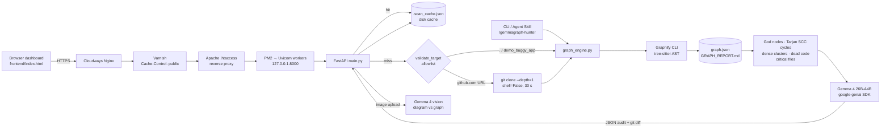

<div align="center">

# 🕸️ GemmaGraph Bug Hunter

**An architecture-aware code-review agent: Graphify AST knowledge graphs + Gemma 4 reasoning.**
Point it at a repo → get circular dependencies, security hotspots, dead code, and a ready-to-apply fix patch.

[](LICENSE)
[](#track-2--best-use-of-gemma-4)
[](#track-3--best-use-of-graphify)
[](#track-4--best-use-of-cloudways)
[](backend/main.py)
[](tests/test_api.py)
[](backend/requirements.txt)

**[Live demo](#)** <!-- replace with your Cloudways URL --> · [GitHub](https://github.com/Ajay-Ankam/gemmagraph-bug-hunter) · [Quickstart](#-quickstart) · [API](#-api-reference) · [Security](#-security-architecture)

</div>

---

## 🧩 The problem

Linters and SAST tools read code **one file at a time**. The bugs that sink real projects are often **between** files:

- `auth.py` imports `db.py`, which imports `auth.py`, so a one-line change in the data layer now breaks login.
- A function nobody calls quietly does `pickle.loads()` on untrusted bytes.
- One "god" module has 40 dependents, and nobody knows what a change there will break.

Feeding a whole repository to an LLM doesn't fix this either: it's expensive and slow, and the model loses the structure in the noise.

## 💡 The solution

GemmaGraph Bug Hunter splits the job between the two tools that are each best at their half:

| Step | Engine | What it does | Deterministic? |
|---|---|---|---|
| 1. **Map** | **Graphify** (tree-sitter AST) | Builds a knowledge graph of every module, function, import and call | ✅ yes, no LLM |
| 2. **Analyse** | Our graph engine | Finds god nodes, import cycles (Tarjan SCC), dense clusters and unreferenced code; picks the 3 most critical files | ✅ yes |
| 3. **Reason** | **Gemma 4** `gemma-4-26b-a4b-it` | Reads *only* the topology + critical files and returns hotspots with `file:line`, severity and blast radius, plus a `git diff` for fix #1 | LLM |
| 4. **See** | **Gemma 4 vision** | Compares your architecture *diagram* with the real graph to spot drift | LLM |

The graph tells Gemma **where to look** and **what breaks downstream**. Gemma supplies the judgment a graph can't.

### Real output on the included [`demo_buggy_app/`](demo_buggy_app)

```text
Graph:   20 nodes · 31 edges · 3 files                     (Graphify, ~3 s)
Cycle:   auth.py → db.py → auth.py                          (graph engine)
CRITICAL db.py:23            SQL injection (f-string query)  (Gemma 4)
CRITICAL db.py:41            command injection, shell=True
CRITICAL legacy_utils.py:16  unsafe pickle deserialization
HIGH     auth.py:11          hard-coded secret
HIGH     auth.py:16          unsalted MD5 password hash
Dead:    load_legacy_session(), old_password_check(), format_username()
Patch:   parameterised query for find_user()  ✔ passes `git apply --check`
```

---

## 🏆 Hackathon Track Alignment

### Track 1 · Best Open-Source AI Project

- **MIT-licensed** ([LICENSE](LICENSE)) bug-hunting harness: FastAPI service, web dashboard and CLI (`backend/cli.py`) with CI-friendly exit codes (`0` clean · `1` hotspots · `2` error).
- **Reusable agent skill** at [`.claude/skills/gemmagraph-hunter/SKILL.md`](.claude/skills/gemmagraph-hunter/SKILL.md). Any AI coding agent that supports Agent Skills can run `/gemmagraph-hunter <path-or-github-url>` to get the full Graphify + Gemma audit. The skill also covers blast-radius queries (`graphify affected`) and a consent-gated `git apply --check` patch flow.
- A **31-test suite** ([`tests/test_api.py`](tests/test_api.py)) covering the API contract, 18 injection/traversal payloads, upload validation and the graph algorithms. It runs offline, with no API key.

### Track 2 · Best Use of Gemma 4

`gemma-4-26b-a4b-it`, called through the official `google-genai` SDK (`from google import genai`), does two different jobs:

1. **Structured code-graph vulnerability reasoning** ([`audit_code_graph`](backend/gemma_agent.py)). Input is the Graphify topology, `GRAPH_REPORT.md` and three line-numbered critical files. Output is JSON (`response_mime_type="application/json"`): `security_hotspots[{file, line, severity, category, explanation, blast_radius}]`, `circular_dependencies`, `dead_code`, `prioritized_fixes`, `git_diff_patch` and `health_score`.
2. **Multimodal architecture-drift detection** ([`audit_architecture_diagram`](backend/gemma_agent.py)). An uploaded diagram (`types.Part.from_bytes`) is compared against the *actual* dependency graph. The output reports matches, drift, trust-boundary violations and recommendations.

**Tuning we measured:**
- The Gemini API rejects `thinking_budget` for Gemma 4 but accepts `thinking_level="MINIMAL"`. That setting brought a full audit from **92 s to about 17–30 s**, with 0 thinking tokens.
- Prompts are capped by trimming each file to 120 lines and sending a compact graph summary (~3.6k input tokens for the demo).
- The prompt treats scanned code as **untrusted data**, as a guard against prompt injection hidden in a repo under review.

### Track 3 · Best Use of Graphify

- **Deterministic tree-sitter AST extraction** (`--code-only`: no LLM, no API cost) produces `graph.json` + `GRAPH_REPORT.md`.
- From that graph we compute **God Nodes** (degree ranking), **import cycles** (iterative Tarjan SCC over `EXTRACTED`/`INFERRED` dependency edges, lifted to file level), **dense communities** (Graphify clusters by edge density) and **dead code** (isolated nodes + callables with no inbound non-structural edges).
- **We catch what the stock report misses.** On a minimal two-file cycle, Graphify's `GRAPH_REPORT.md` printed *"Import Cycles: None detected"*, while our file-level SCC found `a.py → b.py → a.py`.
- **Token efficiency, measured with `graphify benchmark` on this repo:** 12,800 tokens naive vs ~1,485 per graph query, which is **8.6x fewer tokens**. The ratio grows with repository size, because the query cost is bounded while the corpus is not.
- **Our own knowledge graph is committed** for inspection: [`graphify-out/GRAPH_REPORT.md`](graphify-out/GRAPH_REPORT.md) and [`graphify-out/graph.json`](graphify-out/graph.json) (192 nodes · 337 edges · 11 communities).

### Track 4 · Best Use of Cloudways

- **Two-layer caching:**
  - Scan results are persisted to [`backend/.scan_cache.json`](backend/.scan_cache.json), committed to git and pre-warmed. A fresh deploy therefore answers both demo presets in **under 1 ms server time** (~5–10 ms end-to-end locally), with zero Gemini calls.
  - Cached responses carry `Cache-Control: public, max-age=300`, so **Varnish/Nginx** can serve `GET /`, `GET /api/health` and `GET /api/scan/{id}` from the edge. Live scans are `no-store`.
- **PM2 process management** ([`ecosystem.config.js`](ecosystem.config.js)): auto-restart, memory ceiling, log files and boot persistence (`pm2 save`). PM2's *cluster* mode is Node-only, so parallelism comes from **Uvicorn workers** (`--workers 2`). The workers share the disk cache safely through atomic merge-and-replace writes.
- **One-command deploy** ([`deploy_cloudways.sh`](deploy_cloudways.sh)): preflight checks (Python ≥ 3.10, git, `GEMINI_API_KEY`), virtualenv, offline test gate, PM2 zero-downtime reload, health check, then cache pre-warm.
- **Health monitoring:** `GET /api/health` reports uptime, Python version, model, Graphify version, cache contents and five readiness checks (`ready: true|false`).
- **Quota protection:** at most `MAX_LIVE_SCANS` (default 2) concurrent live audits per worker. Beyond that, clients get a clean `429`.

---

## 🏗️ System architecture



<details>
<summary>ASCII version</summary>

```text
 Browser / CLI / Agent Skill
          │
   Nginx → Varnish → Apache(.htaccess proxy) → PM2 → Uvicorn workers (127.0.0.1:8000)
                                                          │
                                                   FastAPI (main.py)
                                ┌─────────── cache hit ───┤
                     .scan_cache.json                     │ miss
                                                 validate_target (allowlist)
                                                          │
                              git clone --depth=1 (github.com only, shell=False, 30 s)
                                                          │
                              Graphify: tree-sitter AST → graph.json + GRAPH_REPORT.md
                                                          │
                  graph_engine: god nodes · SCC cycles · clusters · dead code · top-3 files
                                                          │
                      Gemma 4 (gemma-4-26b-a4b-it): JSON audit + git_diff_patch
                      Gemma 4 vision: architecture diagram ↔ real graph (drift)
```
</details>

| Path | Purpose |
|---|---|
| [`backend/main.py`](backend/main.py) | FastAPI app: routes, disk cache, error envelope, upload validation, headers |
| [`backend/graph_engine.py`](backend/graph_engine.py) | Target validation, cloning, Graphify runner, graph algorithms |
| [`backend/gemma_agent.py`](backend/gemma_agent.py) | Gemma 4 audit + vision prompts (google-genai) |
| [`backend/cli.py`](backend/cli.py) | Command-line interface used by the agent skill |
| [`frontend/index.html`](frontend/index.html) | Tailwind dashboard (served at `/`) |
| [`demo_buggy_app/`](demo_buggy_app) | Deliberately vulnerable sample (⚠️ never deploy) |
| [`tests/test_api.py`](tests/test_api.py) | 31 offline tests |

---

## 🚀 Quickstart

```bash
git clone https://github.com/Ajay-Ankam/gemmagraph-bug-hunter.git
cd gemmagraph-bug-hunter
python -m venv .venv && source .venv/bin/activate      # Windows: .venv\Scripts\activate
pip install -r backend/requirements-dev.txt
cp .env.example .env                                   # then set GEMINI_API_KEY

cd backend && uvicorn main:app --port 8000             # → http://localhost:8000
```

Click **Demo 1: Scan Buggy App** in the dashboard. It's served from the committed cache, so it's instant and needs no key. Tick **Force Refresh** to watch a live Gemma 4 audit.

**CLI / agent skill**

```bash
python backend/cli.py demo_buggy_app                    # Markdown report
python backend/cli.py ~/code/my-project --graph-only    # structure only, no API key
python backend/cli.py https://github.com/owner/repo --json --patch-out fix.patch
```

**Tests**

```bash
python -m pytest            # 31 passed, offline
```

### Cloudways deployment

1. Create a server and application on Cloudways, then SSH in as the application user.
2. Clone this repo, `cp .env.example .env`, and set `GEMINI_API_KEY`.
3. Run `bash deploy_cloudways.sh`. It installs everything, runs the tests, starts PM2 and pre-warms the cache.
4. Copy [`deploy/public_html.htaccess`](deploy/public_html.htaccess) to the app's `public_html/.htaccess` so Apache proxies to Uvicorn on `127.0.0.1:8000`. Uvicorn is never exposed directly.

---

## 📡 API reference

All errors use one envelope: `{"error": "<message>", "status": "error"}`. Tracebacks are never returned.

| Method | Path | Description | Caching |
|---|---|---|---|
| `GET` | `/` | Dashboard | `public, max-age=300` |
| `GET` | `/api/health` | Uptime, Python, model, Graphify, disk cache, readiness checks | `public, max-age=300` |
| `POST` | `/api/scan` | Run (or replay) a scan | hit: `public, max-age=300` · live: `no-store` |
| `GET` | `/api/scan/{scan_id}` | Fetch a cached scan | `public, max-age=300` |
| `POST` | `/api/multimodal-audit` | Gemma 4 vision diagram check | `no-store` |

<details>
<summary><code>POST /api/scan</code></summary>

```http
POST /api/scan
Content-Type: application/json

{"repo_url": "demo_buggy_app", "force_refresh": false}
```

`repo_url` must be `"."`, `"demo_buggy_app"` or `https://github.com/<owner>/<repo>`.

```jsonc
{
  "scan_id": "1966f1a98572", "repo": "demo_buggy_app", "model": "gemma-4-26b-a4b-it",
  "cached": true, "latency_ms": 0.6,
  "timings_ms": {"graphify": 3442.8, "gemma": 29999.5},
  "graph_summary": {
    "stats": {"nodes": 20, "edges": 31, "files": 3, "communities": 3, "confidence": {}, "relations": {}},
    "god_nodes": [{"label": "db.py", "degree": 9, "source_file": "db.py"}],
    "circular_dependencies": [{"cycle": ["auth.py", "db.py", "auth.py"], "evidence": []}],
    "dense_clusters": [], "dead_code": {"unreferenced_callables": []},
    "critical_files": ["db.py", "auth.py"], "file_graph": {"nodes": [], "edges": []}
  },
  "report_md": "# Graph Report ...",
  "audit": {
    "summary": "...", "health_score": 25,
    "security_hotspots": [{"file": "db.py", "line": 23, "severity": "critical",
                           "category": "injection", "explanation": "...", "blast_radius": ["auth.py"]}],
    "circular_dependencies": [], "dead_code": [], "prioritized_fixes": [],
    "git_diff_patch": "--- a/db.py\n+++ b/db.py\n@@ ...",
    "usage": {"input_tokens": 3641, "output_tokens": 1212, "thinking_tokens": 0}
  }
}
```
Errors: `400` rejected target or clone/Graphify failure · `422` invalid body · `429` too many live scans.
</details>

<details>
<summary><code>POST /api/multimodal-audit</code></summary>

`multipart/form-data` with `scan_id` (from a previous scan) and `image` (PNG/JPEG/WebP, ≤ 5 MB).

```json
{"scan_id": "1966f1a98572", "repo": "demo_buggy_app", "model": "gemma-4-26b-a4b-it",
 "filename": "architecture.png", "analysis_markdown": "## Matches ...", "latency_ms": 18023.1}
```
Errors: `404` unknown scan · `413` > 5 MB · `415` disallowed type or spoofed content · `502` model error.
</details>

---

## 🔒 Security architecture

The service runs untrusted input (URLs, uploads and **the scanned code itself**) through subprocesses and an LLM, so every boundary has its own control:

| Threat | Control | Where |
|---|---|---|
| Command / argument injection via `repo_url` | Strict allowlist: `.`, `demo_buggy_app`, or `^https://github\.com/<owner>/<repo>(\.git)?/?$`. No whitespace, control chars, query strings, credentials or other hosts. Rejected **before** any subprocess runs. | `graph_engine.validate_target`, `ScanRequest` validator |
| Shell injection | Every subprocess uses list argv with `shell=False`; `git clone --depth=1 -- <url> <dir>` (`--` blocks option injection); `GIT_TERMINAL_PROMPT=0` | `graph_engine.py` |
| Path traversal | Only two local targets, resolved from fixed paths; file reads are `resolve()`d and must stay inside the checkout (defeats symlink escapes) | `validate_target`, `read_critical_files` |
| Resource exhaustion | 30 s clone timeout, 300 s Graphify timeout, 200-char target limit, max 2 concurrent live scans per worker (`429`) | `graph_engine.py`, `main.py` |
| Malicious uploads | MIME allowlist (PNG/JPEG/WebP), 5 MB cap (read is bounded), **magic-byte signature check** against the declared type | `main._validate_image` |
| Information leakage | Global exception handlers return `{"error","status"}` only; tracebacks are logged server-side; model/API error details are not echoed | `main.py` handlers |
| Prompt injection from scanned repos | The prompt marks source and report as untrusted data and asks for embedded instructions to be reported as findings | `gemma_agent.audit_code_graph` |
| XSS from model output | Dashboard escapes all values; Markdown is rendered through DOMPurify | `frontend/index.html` |
| Secret exposure | `.env` git-ignored (`.env.*` too, except `.env.example`); `chmod 600 .env` on deploy; Uvicorn bound to `127.0.0.1` behind the proxy; committed cache/graph files verified free of keys and absolute paths | `.gitignore`, `deploy_cloudways.sh` |

Coverage: `tests/test_api.py` fires 18 malicious targets (`; rm -rf /`, `$(…)`, backticks, `../../etc/passwd`, `file://`, `ssh`, `--upload-pack=…`, credential URLs, …) plus spoofed, oversized and disallowed uploads, and asserts that no traceback ever leaks.

> ⚠️ `demo_buggy_app/` is **intentionally vulnerable** sample code for the scanner. It is never imported or executed by the service.

---

## 📄 License

[MIT](LICENSE) © 2026 Ajay Ankam
